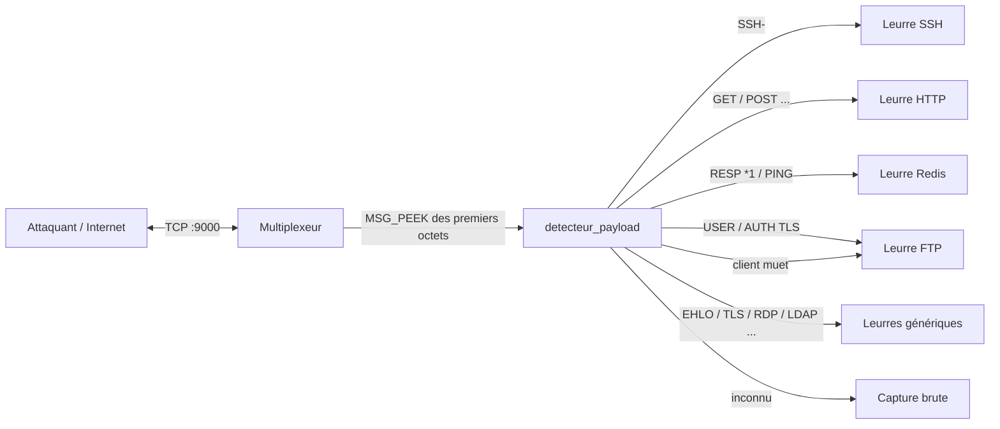

# Honeypot

Honeypot multi-protocole fait maison (SSH, FTP, HTTP, MySQL, Redis + Telnet, SMTP, POP3, LDAP, RDP, PostgreSQL)
qui journalise chaque tentative d'attaque au format **JSON Lines** (`logs/events.jsonl`).
Une couche de **payload detection** (inspirée de [Honeytrap](https://github.com/honeytrap/honeytrap))
permet de recevoir tous les protocoles sur un seul port et d'aiguiller chaque connexion vers le bon leurre.

## Lancement en 1 ligne (Docker)

```bash
cp .env.example .env && docker compose up --build -d
```

Les événements arrivent dans `./logs/events.jsonl` :

```bash
tail -f logs/events.jsonl
docker compose logs -f honeypot     # sortie console
docker compose down                 # arrêt
```

> [!NOTE]
> Sur Linux, le dossier `./logs` doit être modifiable par l'utilisateur du conteneur (uid 1000) :
> `mkdir -p logs && sudo chown 1000:1000 logs`.
> Les ports 22, 21, 80... doivent être libres sur l'hôte (sinon modifier `HOST_PORT_*` dans `.env`,
> par exemple déplacer le vrai sshd sur un autre port).

## Lancement local (sans Docker)

```bash
python -m venv .venv && source .venv/bin/activate    # Windows : .venv\Scripts\activate
pip install -r requirements.txt
cp .env.example .env
python -m src.main
```

## Ports

| Service | Port conteneur / local | Port hôte (Docker) | Interaction |
|---|---|---|---|
| HTTP (faux WordPress, `.env` leurre) | 8080 | 80 | moyenne |
| SSH (accepte tout mot de passe, shell simulé) | 2222 | 22 | moyenne |
| FTP | 2121 | 21 | moyenne |
| Redis | 6379 | 6379 | moyenne |
| MySQL (handshake 5.7) | 3306 | 3306 | moyenne |
| Telnet / SMTP / POP3 / LDAP / RDP / PostgreSQL | 2323 / 2525 / 1110 / 3890 / 3389 / 5432 | 23 / 25 / 110 / 389 / 3389 / 5432 | faible (bannière + capture) |
| **Multiplexeur (payload detection)** | 9000 | 9000 | détecte puis aiguille |

Tous les ports sont configurables via `.env` (voir [.env.example](.env.example)).

## Payload detection (multiplexeur)



Le détecteur regarde les premiers octets **sans les consommer**, devine le protocole puis transmet la connexion
au handler du leurre. Chaque décision est journalisée (`MUX_DETECTION`).
Limite : pour les protocoles où le serveur parle en premier (FTP, SMTP, MySQL, POP3), le client n'envoie rien :
après `MUX_DELAI` secondes on bascule sur `MUX_DEFAUT` (FTP par défaut).

## Format des logs

```json
{"horodatage": "2026-10-23T12:00:00+00:00", "protocole": "SSH_AUTH", "ip_source": "203.0.113.7", "port_source": 51514, "donnees": {"nom_utilisateur": "root", "mot_de_passe": "123456"}}
```

## Tests

```bash
pytest -v                                  # unitaires + intégration (leurres démarrés en local)
docker compose up -d --build
HONEYPOT_EXTERNAL=1 pytest tests/test_integration.py -v   # attaque le honeypot Docker via les ports publiés
```

La CI GitHub Actions (`.github/workflows/ci.yml`) lance `pytest` à chaque push et vérifie le build Docker.

## Arborescence

```text
├── src/
│   ├── main.py                    # point d'entrée (python -m src.main)
│   ├── core/                      # config, logs, payload detector, multiplexeur
│   └── services/                  # leurres FTP / HTTP / MySQL / Redis / SSH / génériques
├── tests/                         # test_unitaires.py, test_integration.py
├── docs/                          # suivi_projet.md, Plan_Action_Honeypot.md, perspectives.md
├── logs/                          # events.jsonl (ignoré par git)
├── Dockerfile · docker-compose.yml · .env.example · requirements.txt
```

## Sécurité

- Conteneur non-root, système de fichiers en lecture seule, `cap_drop: ALL`, `no-new-privileges`, limites mémoire/PIDs.
- Ne **jamais** monter `/var/run/docker.sock` dans ce conteneur : un attaquant qui compromet un leurre prendrait la main sur l'hôte.
- `SSH_SANDBOX=simulate` (défaut) : aucune commande n'est réellement exécutée.
  `SSH_SANDBOX=docker` exécute via `docker exec sandbox_generique` (usage hors conteneur uniquement).

## Perspectives

Voir [docs/perspectives.md](docs/perspectives.md) (payload detection avancée, intégration SIEM / ELK).
